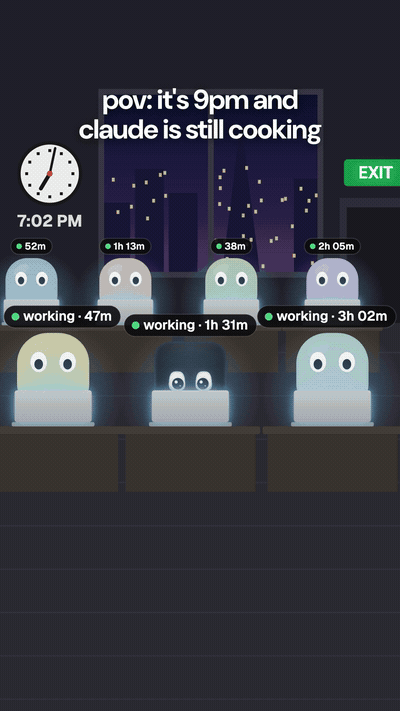
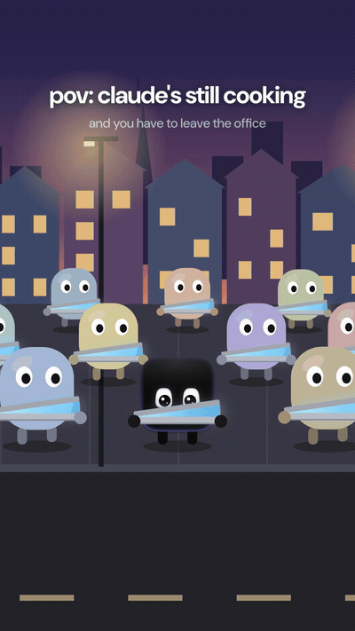
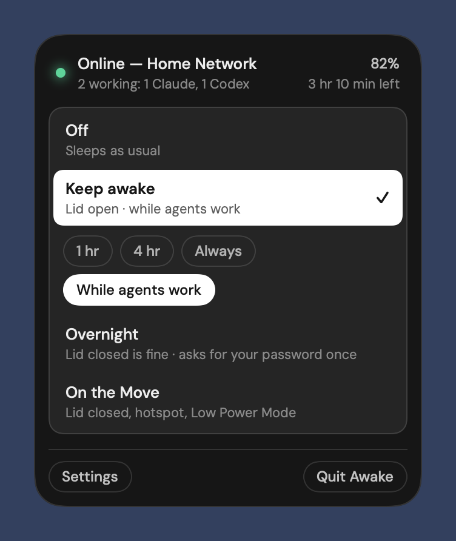
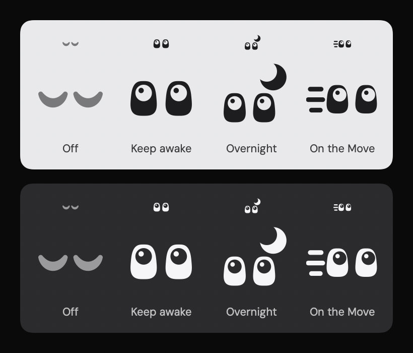
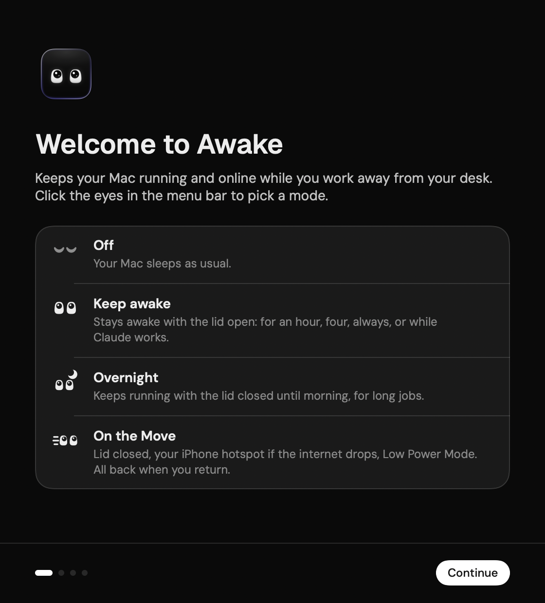

# Awake

<table>
  <tr>
    <td align="center" width="50%">
      <a href="https://github.com/user-attachments/assets/3914583e-b4d2-485c-b50e-6f05e22834e0"></a><br>
      <sub>Can't leave until Claude finishes? · <a href="https://github.com/user-attachments/assets/3914583e-b4d2-485c-b50e-6f05e22834e0">▶ with sound</a></sub>
    </td>
    <td align="center" width="50%">
      <a href="https://github.com/user-attachments/assets/ea3f0785-f45f-4790-8556-3cadddbd4b48"></a><br>
      <sub>No more half-open laptop walk · <a href="https://github.com/user-attachments/assets/ea3f0785-f45f-4790-8556-3cadddbd4b48">▶ with sound</a></sub>
    </td>
  </tr>
</table>

  

**Keep your Mac running and online while you work away from your desk.** Awake lives in your menu bar as a pair of eyes. Pick a mode, close the lid, and your work, or your coding agents (Claude Code, Codex and others), keep going.



## Four modes



- **Off**: your Mac sleeps as usual.
- **Keep awake**: stays awake with the lid open, for 1 hour, 4 hours, always, or *while agents work* (it lets the Mac sleep a few minutes after the last coding session goes idle).
- **Overnight**: keeps running with the lid open or closed, for long jobs. It ends at the morning hour you pick (9 AM by default), when your agents finish, or when you turn it off. It changes nothing else.
- **On the Move**: for when you pack up. The Mac keeps running with the lid closed, joins your iPhone hotspot if the internet drops, and turns on Low Power Mode and a firewall shield. When you're back, everything goes back to how it was.

## And a few things that keep work from stalling

- **Warnings** when the disk is almost full, memory runs low, the CPU stays busy on battery, the battery is running out, or a charger is too weak to keep up.
- **Café Wi-Fi**: tells a sign-in page apart from a dead connection, and switches to your hotspot only when the Wi-Fi is really down.
- **Public Wi-Fi shield**: on any Wi-Fi you haven't trusted, turns on the macOS firewall with stealth mode and points out sharing that's on. When one of your trusted networks is in range again (home, the office), it offers to switch back.
- **Coding sessions**: counts the Claude Code, Codex, Gemini CLI, Aider, OpenCode and other agent sessions you have open, and shows how many are working. A session's helpers (MCP servers, wrappers, agents it starts itself) don't count twice. Codex app servers count distinct open session files. Other agents can use CPU activity as a working signal; an active nested agent keeps at least one parent session marked working when its owning conversation cannot be identified.
- **Safety stop**: if the Mac gets hot in a bag or the battery drops to 20%, Awake turns everything off and lets it sleep.
- **Claude Code**: a built-in MCP server, so you can say "I got to move" or "going to bed, keep it running" and Claude switches the mode for you.

## Install

Paste this in Terminal:

```bash
curl -fsSL https://raw.githubusercontent.com/arthur-bump-pm/awake-mac/main/install.sh | bash
```

It downloads the latest release, checks it against the release's checksum and signature, puts Awake in Applications and opens it. Run it again to update. ([Read the script](install.sh) first if you like; it's short.)

Or with [Homebrew](https://brew.sh):

```bash
brew install --cask arthur-bump-pm/tap/awake
```

Homebrew also puts `awakectl` on your PATH and updates Awake with `brew upgrade`.

Or download **Awake-x.y.z.zip** from [Releases](https://github.com/arthur-bump-pm/awake-mac/releases/latest), unzip it and drag Awake to Applications. Awake isn't notarized by Apple, so the first time you open a downloaded copy, macOS refuses: go to System Settings → Privacy & Security and click **Open Anyway**. The two commands above skip that step.

A short welcome then walks you through the rest: the modes, two optional permissions, your hotspot and trusted Wi-Fi, and Claude Code. Awake needs macOS 14 Sonoma or later and runs on Apple silicon and Intel Macs. If you use a menu bar manager (Bartender, Ice, Hidden Bar), drag Awake's eyes to the visible side.



### Build from source

Needs the Xcode command-line tools.

```bash
git clone https://github.com/arthur-bump-pm/awake-mac.git
cd awake-mac
./build_app.sh --install
```

## Connect Claude Code

```bash
claude mcp add --scope user awake -- /Applications/Awake.app/Contents/MacOS/awakectl mcp
```

New Claude Code sessions then understand "hey, I got to move", "I'm back at my desk", "going to bed, keep it running", and can check the Mac's health (free disk, memory, battery) before a long job. The command is also in Awake's Settings → Setup, with a Copy button.

## Command line

`awakectl` is inside the app (Homebrew links it for you). To type it as plain `awakectl` otherwise, link it into a folder on your PATH:

```bash
mkdir -p ~/.local/bin && ln -s /Applications/Awake.app/Contents/MacOS/awakectl ~/.local/bin/awakectl
```

(If `~/.local/bin` isn't on your PATH yet, add `export PATH="$HOME/.local/bin:$PATH"` to `~/.zshrc`.)

```bash
awakectl status
awakectl awake on|off|agents|<minutes>   # Keep awake ("agents" = while coding agents work)
awakectl overnight on|off|agents|always  # Overnight: until morning, until your agents finish, or until turned off
awakectl move on|off                     # On the Move
awakectl hotspot on|off|join             # auto-hotspot, or join your hotspot now
```

## Permissions and privacy

| What | Why |
|---|---|
| Your password, once | For Overnight and On the Move. It installs `/etc/sudoers.d/awake`, which lets Awake run exactly these commands without asking again, and nothing else: `pmset -a disablesleep 0/1`, `pmset -b lowpowermode 0/1`, `pmset sleepnow`, and the firewall's `--setglobalstate on/off` and `--setstealthmode on/off`. |
| Location access | macOS hides Wi-Fi names from apps without it. Awake never reads your location. |
| Notifications | To tell you when it switched networks, ended a mode, or turned something off for safety. |

Awake has no account, no analytics and no server. Its only network requests are connectivity checks: Apple's `captive.apple.com` page, and Google's `generate_204` when a network blocks plain HTTP. Settings stay on your Mac; the hotspot password goes in your login keychain.

The sudoers rule works for anything running as your user, not only Awake. The worst a misbehaving app could do with it is keep your Mac awake, put it to sleep, or switch the firewall. If that trade-off doesn't suit you, skip the admin permission: Keep awake and the warnings work without it.

## Known limitations

- A network is trusted by its name, which anyone can copy. When switching back to a trusted network, Awake won't join an open network that copies the name of one your Mac knows with a password, but the public Wi-Fi shield stays down on any network with a trusted name.
- Failing over between public Wi-Fi and your hotspot switches the shield each time: down on the hotspot, up again on the public Wi-Fi.

## Uninstall

Installed with Homebrew: `brew uninstall --cask --zap awake`, then `sudo rm /etc/sudoers.d/awake` if you set up the admin permission. Otherwise, quit Awake first (quitting puts back everything it changed), then:

```bash
claude mcp remove awake -s user      # if you connected Claude Code
sudo rm /etc/sudoers.d/awake          # if you set up the admin permission
rm -rf /Applications/Awake.app
defaults delete io.github.arthur-bump-pm.Awake
rm -rf ~/Library/Application\ Support/Awake
rm -f ~/.local/bin/awakectl                          # if you linked it
security delete-generic-password -s "Awake Hotspot"   # if you saved a hotspot password
```

Turn off Launch at login in System Settings → General → Login Items if it's still listed.

## Versions

| Version | Status | Highlights |
|---|---|---|
| **1.1.0** | ✅ released 2026-10-30 | Counts Codex and other coding agents, not only Claude Code; separate app-server session counts and activity tracking for long jobs |
| **1.0.1** | ✅ released 2026-10-29 | Install with one line in Terminal or with Homebrew; the license now ships inside the app |
| **1.0.0** | ✅ released 2026-10-29 | Four modes (Keep awake, Overnight, On the Move); a menu bar icon that shows the mode; welcome on first launch; health and battery warnings; café Wi-Fi sign-in detection; auto-hotspot; public Wi-Fi shield and switching back to trusted Wi-Fi; safety stop; `awakectl` and an MCP server for Claude Code |

## Credits

- Fonts: [DM Sans](https://github.com/googlefonts/dm-fonts) and [Geist](https://github.com/vercel/geist-font), both under the SIL Open Font License (license files in `Resources/Fonts`).

MIT License. See [LICENSE](LICENSE).
